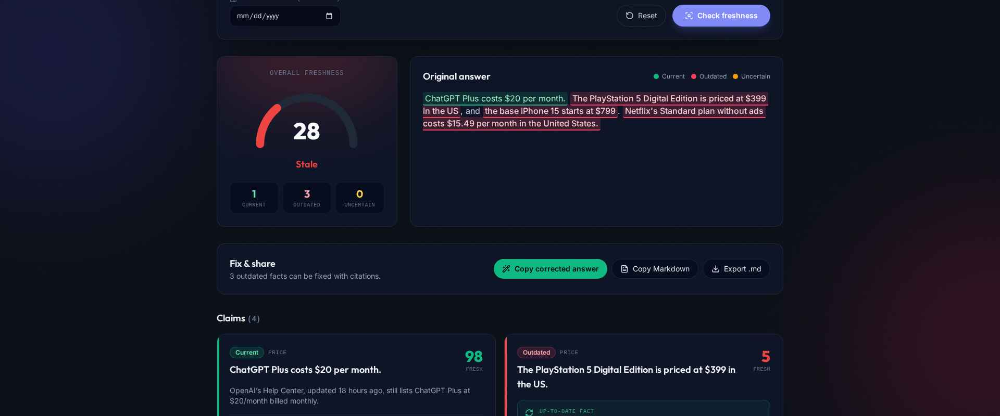
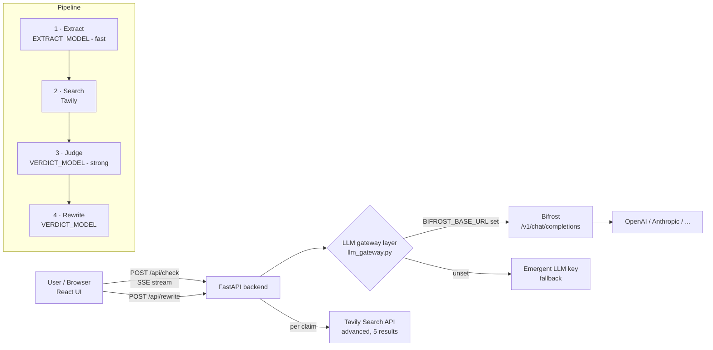
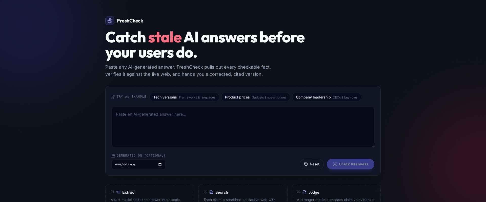
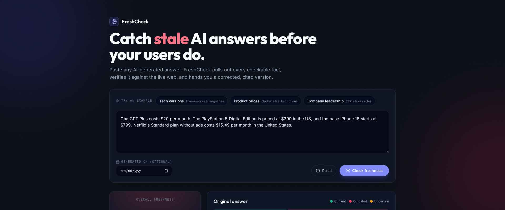
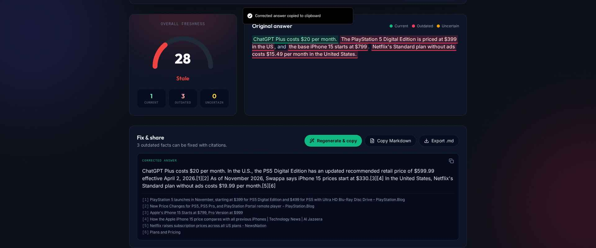
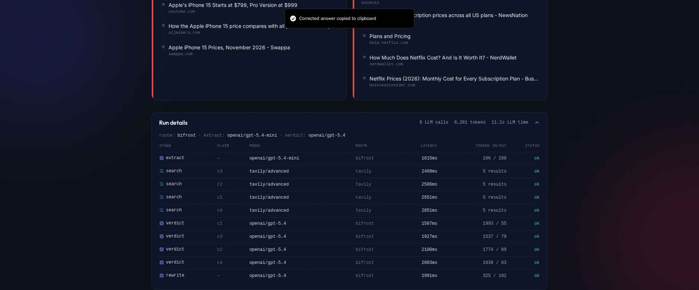
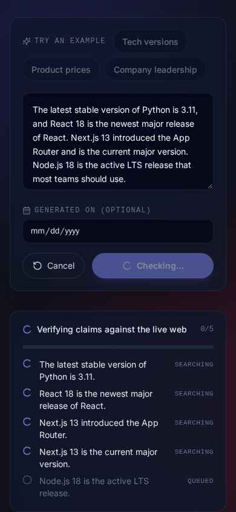

# FreshCheck

> **Catch stale AI answers before your users do.**

FreshCheck finds facts in AI-generated answers that have gone out of date. Paste any answer. It pulls out every checkable claim (prices, versions, dates, people in roles, statistics, rules), checks each one against the live web, gives each a verdict (**Current / Outdated / Uncertain**), and writes a corrected answer with citations.



---

## The problem

LLMs are trained up to a cutoff date. Their answers sound confident, but the facts in them go stale:

- *"Python 3.11 is the latest version"*
- *"The PS5 Digital Edition costs $399"*
- *"Pat Gelsinger is the CEO of Intel"*

Teams that put AI answers in front of users (support bots, docs assistants, content tools) don't have a cheap way to catch these before users see them.

## The solution

FreshCheck runs every claim through a small, auditable pipeline:

1. **Extract**: a cheap, fast model splits the answer into atomic, checkable claims. Each claim keeps its exact quote so it can be highlighted in the answer.
2. **Search**: each claim runs its own **Tavily** search (`search_depth: advanced`, `include_answer: true`, `max_results: 5`).
3. **Judge**: a stronger model compares the claim with the evidence it found. It returns a verdict, a 0–100 freshness score, the up-to-date fact, a one-line reason and the sources it relied on.
4. **Fix**: one click rewrites the whole answer with the outdated facts replaced and cited (`[1]`, `[2]`…).

**Sources are never invented.** Source links are always taken from Tavily's results, never generated by the LLM. If Tavily returns nothing, the claim is marked **Uncertain**.

Results stream live over Server-Sent Events, so you can watch each claim go from queued → searching → verdict.

## Features

- Overall freshness gauge, plus a count of Current, Outdated and Uncertain claims
- Original answer with each claim highlighted inline (green / red / amber). Click a highlight to jump to its card.
- A card per claim with verdict, score, up-to-date fact, reason, clickable sources (title, domain, date) and **Copy fix with citation**
- **Copy corrected answer**: rewrites the full answer with fixes and numbered citations
- **Copy Markdown / Export .md**: a full report you can share
- **Run details** (collapsible): one row per LLM and search call, showing stage, model, route, latency and tokens in/out
- **Routed via Bifrost / Direct** badge in the footer
- 3 one-click examples (tech versions, product prices, company leadership), plus empty and error states
- Dark, mobile-friendly UI

## Architecture



```
backend/
  server.py        # FastAPI: /api/check (SSE), /api/rewrite, /api/config
  llm_gateway.py   # single entry point for every LLM call (Bifrost or Emergent fallback), logs model/latency/tokens
frontend/src/
  App.js, lib/freshcheck.js, components/*.jsx
bifrost/config.json  # Bifrost provider config used by docker-compose
docker-compose.yml   # bifrost + mongo + backend + frontend
```

### SSE events from `POST /api/check`

| event | payload |
|---|---|
| `meta` | `{route, extract_model, verdict_model}` |
| `status` | `{stage: "extracting"}` |
| `claims` | `{claims: [{id, claim, quote, category, search_query}]}` |
| `claim_start` | `{id}` |
| `llm_call` | `{kind: "llm"\|"search", stage, ref, model, route, latency_ms, prompt_tokens, completion_tokens, results, status}` |
| `claim_result` | `{id, verdict, freshness_score, updated_fact, reason, sources: [{title, url, date}]}` |
| `done` | `{overall_score, counts}` |
| `error` | `{message}` |

## How Tavily is used

For each claim, the backend calls `POST https://api.tavily.com/search`:

```json
{ "query": "<claim-specific search query>", "search_depth": "advanced", "include_answer": true, "max_results": 5 }
```

The verdict model receives the numbered results (title, published date, URL, content) and Tavily's `answer` summary, and returns `source_ids` pointing to those numbers. The backend then turns those IDs back into the real Tavily URLs and titles, so the model never writes a URL itself. Up to 4 claims are verified in parallel.

## How Bifrost is used

[Bifrost](https://github.com/maximhq/bifrost) by Maxim AI is a fast, OpenAI-compatible LLM gateway. **Every LLM call in FreshCheck goes through `backend/llm_gateway.py`.**

- When `BIFROST_BASE_URL` is set, the gateway uses the OpenAI SDK pointed at `${BIFROST_BASE_URL}/v1` (`/v1/chat/completions`), with `BIFROST_API_KEY` as the bearer token if you have one.
- **Model routing in Bifrost style** (`provider/model` names):
  - `EXTRACT_MODEL` (for example `openai/gpt-4o-mini`): cheap and fast, used for claim extraction
  - `VERDICT_MODEL` (for example `openai/gpt-4o`): stronger, used for verdicts and the corrected-answer rewrite
- Bifrost resolves the provider from the prefix, so you can switch to `anthropic/...` or other providers without changing any code.
- When `BIFROST_BASE_URL` is **unset**, the gateway falls back to the Emergent LLM key, so the hosted demo keeps working.
- Every call records its model, route, latency and token usage. These appear in the UI's **Run details** panel, and the footer badge shows **Routed via Bifrost** or **Direct**.

## Environment variables (backend)

| Variable | Required | Description |
|---|---|---|
| `TAVILY_API_KEY` | yes | Tavily Search API key |
| `BIFROST_BASE_URL` | no | e.g. `http://bifrost:8080`. When set, all LLM calls go through Bifrost |
| `BIFROST_API_KEY` | no | Bearer key if your Bifrost requires one |
| `EXTRACT_MODEL` | yes | Fast model for claim extraction, e.g. `openai/gpt-4o-mini` |
| `VERDICT_MODEL` | yes | Strong model for verdicts and rewrites, e.g. `openai/gpt-4o` |
| `EMERGENT_LLM_KEY` | only without Bifrost | Fallback key when `BIFROST_BASE_URL` is unset |
| `MONGO_URL`, `DB_NAME` | yes | Present for the stack; checks are not stored |
| `CORS_ORIGINS` | no | Defaults to `*` |

Frontend: `REACT_APP_BACKEND_URL` (for example `http://localhost:8001`).

## Local setup with docker-compose

```bash
git clone https://github.com/<you>/freshcheck.git && cd freshcheck
cat > .env <<'EOF'
OPENAI_API_KEY=sk-...          # used by Bifrost (see bifrost/config.json)
TAVILY_API_KEY=tvly-...
EXTRACT_MODEL=openai/gpt-4o-mini
VERDICT_MODEL=openai/gpt-4o
EOF
docker compose up --build
```

- App: http://localhost:3000
- Backend: http://localhost:8001/api/config (should show `"route": "bifrost"`)
- Bifrost UI and logs: http://localhost:8080

To add providers or keys, edit `bifrost/config.json` (for example, add an `anthropic` block and set `VERDICT_MODEL=anthropic/claude-sonnet-4-5`).

### Without Docker

```bash
# Bifrost
npx -y @maximhq/bifrost -app-dir ./bifrost -port 8080
# backend
cd backend && pip install -r requirements.txt --extra-index-url https://d33sy5i8bnduwe.cloudfront.net/simple/
BIFROST_BASE_URL=http://localhost:8080 uvicorn server:app --port 8001
# frontend
cd frontend && yarn install && REACT_APP_BACKEND_URL=http://localhost:8001 yarn start
```

## API

- `GET /api/config`: returns `{route, extract_model, verdict_model}`
- `POST /api/check`: body `{answer, generated_date?}`, returns an SSE stream (see the events table above)
- `POST /api/rewrite`: body `{answer, claims}`, returns `{rewritten, sources:[{n,title,url}], changed, log}`

## Screenshots

| | |
|---|---|
| Home and examples |  |
| Example loaded |  |
| Gauge, highlights and claims |  |
| Corrected answer with citations |  |
| Run details, routed via Bifrost |  |
| Mobile |  |

## License

[MIT](LICENSE)
