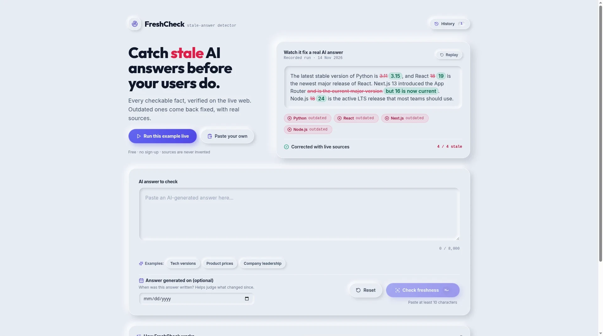
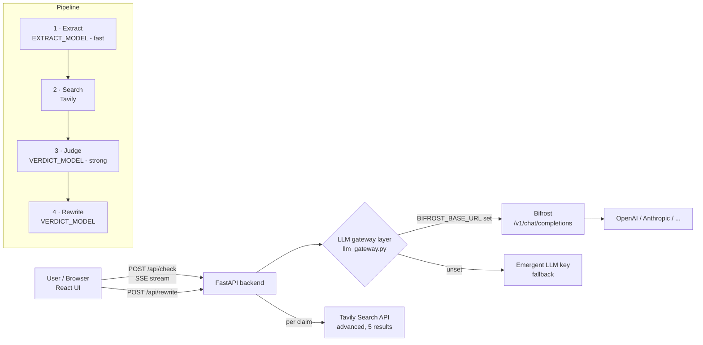
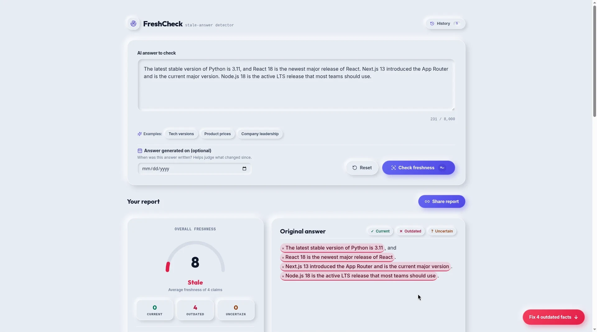
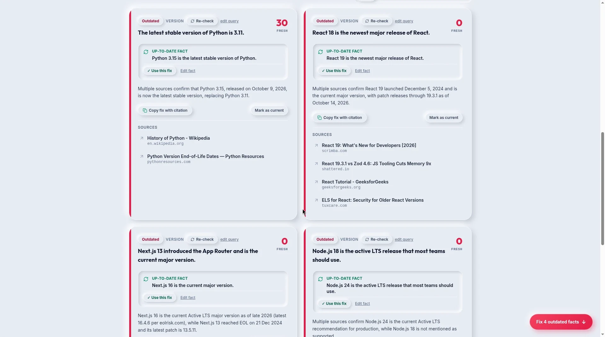
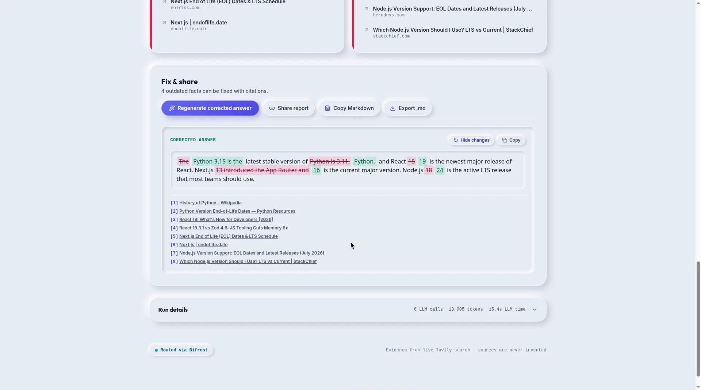
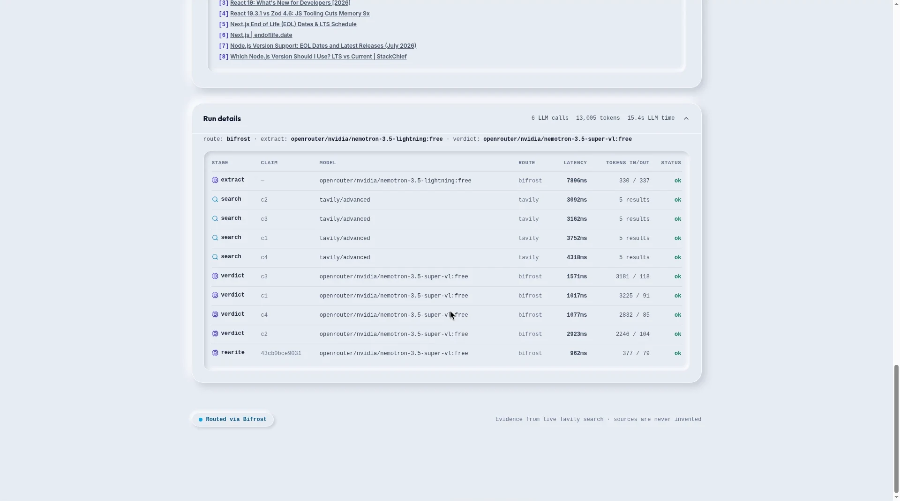
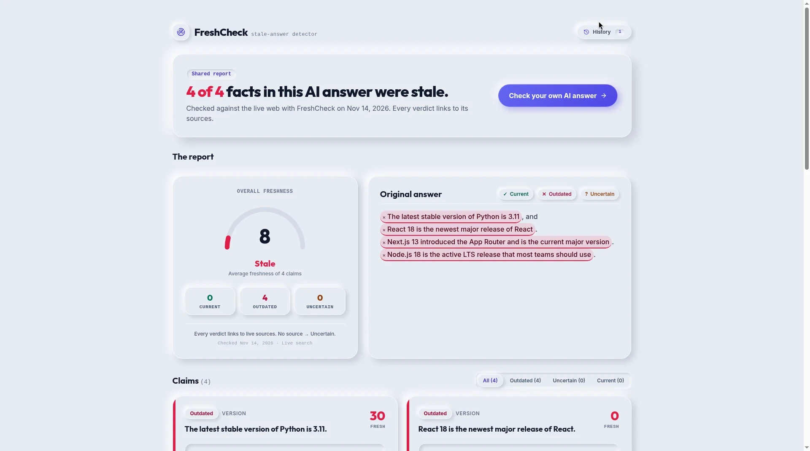

# FreshCheck

> **Catch stale AI answers before your users do.**

FreshCheck finds facts in AI-generated answers that have gone out of date. Paste any answer. It pulls out every checkable claim (prices, versions, dates, people in roles, statistics, rules), checks each one against the live web, gives each a verdict (**Current / Outdated / Uncertain**), and writes a corrected answer with citations.



---

## The problem

LLMs are trained up to a cutoff date. Their answers sound confident, but the facts in them go stale:

- *"Python 3.11 is the latest version"*
- *"The PS5 Digital Edition costs $399"*
- *"Pat Gelsinger is the CEO of Intel"*

Teams that put AI answers in front of users (support bots, docs assistants, content tools) don't have a cheap way to catch these before users see them.

## The solution

FreshCheck runs every claim through a small, auditable pipeline:

1. **Extract**: a cheap, fast model splits the answer into atomic, checkable claims. Each claim keeps its exact quote so it can be highlighted in the answer.
2. **Search**: each claim runs its own **Tavily** search (`search_depth: advanced`, `include_answer: true`, `max_results: 5`).
3. **Judge**: a stronger model compares the claim with the evidence it found. It returns a verdict, a 0 to 100 freshness score, the up-to-date fact, a one-line reason and the sources it relied on.
4. **Fix**: one click rewrites the whole answer with the outdated facts replaced and cited (`[1]`, `[2]`…).

**Sources are never invented.** Source links are always taken from Tavily's results, never generated by the LLM. If Tavily returns nothing, the claim is marked **Uncertain**.

Results stream live over Server-Sent Events, so you can watch each claim go from queued → searching → verdict.

## Features

- Overall freshness gauge, plus a count of Current, Outdated and Uncertain claims
- Original answer with each claim highlighted inline (green / red / amber). Click a highlight to jump to its card.
- A card per claim with verdict, score, up-to-date fact, reason, clickable sources (title, domain, date) and **Copy fix with citation**
- **Copy corrected answer**: rewrites the full answer with fixes and numbered citations
- **Copy Markdown / Export .md**: a full report you can share
- **Run details** (collapsible): one row per LLM and search call, showing stage, model, route, latency and tokens in/out
- **Routed via Bifrost / Direct** badge in the footer
- 3 one-click examples (tech versions, product prices, company leadership), plus empty and error states
- **Per-claim re-check**, with an optional custom search query, without rerunning the whole answer
- **Accept, ignore or edit each fix**, plus a "Mark as current" override. The rewrite uses only the fixes you accepted
- **Local history** of recent checks (stored in your browser), so you can reopen a past run
- Character counter (max 8,000), a note when only the first 12 claims were checked, and Cancel that keeps your text
- JSON (non-streaming) API mode for scripts and CI
- **Hero demo** "Watch it fix a real AI answer": replays a recorded run of the Tech versions example (14 Nov 2026) on the home page, with no API call, next to a **Run this example live** button
- **Shareable report links**: **Share report** copies a read-only link. The whole report is compressed into the URL hash (`#r=...`), so nothing is stored on a server. The shared view treats the link as untrusted input (only http(s) source links, length-capped fields)
- Soft neumorphic (Soft UI) design in light indigo, emerald and rose, with a responsive layout

## Architecture



```
backend/
  server.py        # FastAPI: /api/check (SSE), /api/rewrite, /api/config
  llm_gateway.py   # single entry point for every LLM call (Bifrost or Emergent fallback), logs model/latency/tokens
frontend/src/
  App.js, lib/freshcheck.js, components/*.jsx
bifrost/config.json  # Bifrost provider config used by docker-compose
docker-compose.yml   # bifrost + backend + frontend (the mongo service is optional and unused)
Dockerfile, start.sh, render.yaml  # single-container deploy (Bifrost + backend) on Render
frontend/public/_redirects        # SPA routing on Cloudflare Pages
```

### SSE events from `POST /api/check`

| event | payload |
|---|---|
| `meta` | `{run_id, route, extract_model, verdict_model}` |
| `status` | `{stage: "extracting"}` |
| `claims` | `{claims: [{id, claim, quote, category, region, condition, search_query}], truncated, total_found}` |
| `claim_start` | `{id}` |
| `llm_call` | `{kind: "llm"\|"search", stage, ref, model, route, latency_ms, prompt_tokens, completion_tokens, results, cached, status}` |
| `claim_result` | `{id, verdict, freshness_score, updated_fact, reason, sources: [{title, url, date}]}` |
| `done` | `{overall_score, counts}` |
| `error` | `{message}` |

## How Tavily is used

For each claim, the backend calls `POST https://api.tavily.com/search`:

```json
{ "query": "<claim-specific search query>", "search_depth": "advanced", "include_answer": true, "max_results": 5 }
```

The verdict model receives the numbered results (title, published date, URL, content) and Tavily's `answer` summary, and returns `source_ids` pointing to those numbers. The backend then turns those IDs back into the real Tavily URLs and titles, so the model never writes a URL itself. Up to 4 claims are verified in parallel.

## How Bifrost is used

[Bifrost](https://github.com/maximhq/bifrost) by Maxim AI is a fast, OpenAI-compatible LLM gateway. **Every LLM call in FreshCheck goes through `backend/llm_gateway.py`.**

- When `BIFROST_BASE_URL` is set, the gateway uses the OpenAI SDK pointed at `${BIFROST_BASE_URL}/v1` (`/v1/chat/completions`), with `BIFROST_API_KEY` as the bearer token if you have one.
- **Model routing in Bifrost style** (`provider/model` names):
  - `EXTRACT_MODEL` (for example `openai/gpt-4o-mini`): cheap and fast, used for claim extraction
  - `VERDICT_MODEL` (for example `openai/gpt-4o`): stronger, used for verdicts and the corrected-answer rewrite
- **OpenRouter** works as a Bifrost provider: set `OPENROUTER_API_KEY` and use `openrouter/...` model names (when only `OPENROUTER_API_KEY` is set, the defaults switch to `openrouter/nvidia/nemotron-3.5-lightning:free` for extraction and `openrouter/nvidia/nemotron-3.5-super-vl:free` for verdicts).
- Bifrost resolves the provider from the prefix, so you can switch to `anthropic/...` or other providers without changing any code.
- When `BIFROST_BASE_URL` is **unset**, the gateway falls back to the Emergent LLM key, so the hosted demo keeps working.
- Every call records its model, route, latency and token usage. These appear in the UI's **Run details** panel, and the footer badge shows **Routed via Bifrost** or **Direct**.

## Environment variables (backend)

| Variable | Required | Description |
|---|---|---|
| `TAVILY_API_KEY` | yes | Tavily Search API key |
| `BIFROST_BASE_URL` | no | e.g. `http://bifrost:8080`. When set, all LLM calls go through Bifrost |
| `BIFROST_API_KEY` | no | Bearer key if your Bifrost requires one |
| `EXTRACT_MODEL` | no (default `openai/gpt-4o-mini`, or `openrouter/nvidia/nemotron-3.5-lightning:free` with OpenRouter) | Fast model for claim extraction |
| `VERDICT_MODEL` | no (default `openai/gpt-4o`, or `openrouter/nvidia/nemotron-3.5-super-vl:free` with OpenRouter) | Strong model for verdicts and rewrites |
| `EMERGENT_LLM_KEY` | only without Bifrost | Fallback key when `BIFROST_BASE_URL` is unset |
| `RATE_LIMIT_PER_24H` | no (default 10) | Per-IP checks per window (`RATE_LIMIT_PER_10MIN` is still read as a fallback name) |
| `RATE_LIMIT_WINDOW_SECONDS` | no (default 86400, 24 hours) | Length of the rate limit window |
| `RATE_LIMIT_ALLOWLIST` | no | Comma-separated IPs exempt from the rate limit |
| `RUN_TIMEOUT_SECONDS` | no (default 120) | Total time limit for one check run |
| `TRUSTED_PROXY_HOPS` | no (default 2) | Number of trailing X-Forwarded-For entries added by your own proxies (0 when there is no proxy) |
| `OPENROUTER_API_KEY` | no | Provider key used by Bifrost for `openrouter/...` models |
| `MONGO_URL`, `DB_NAME` | no | Unused leftovers of the base stack; checks are not stored |
| `CORS_ORIGINS` | no | Comma-separated allowed origins. Defaults to `*` if unset, so set it to your frontend origin in production (see `render.yaml`) |

Frontend: `REACT_APP_BACKEND_URL` (for example `http://localhost:8001`).

## Local setup with docker-compose

```bash
git clone https://github.com/<you>/freshcheck.git && cd freshcheck
cp backend/.env.example backend/.env      # dummy values, edit TAVILY_API_KEY etc.
cp frontend/.env.example frontend/.env    # REACT_APP_BACKEND_URL=http://localhost:8001
cat > .env <<'EOF'
OPENAI_API_KEY=sk-...          # used by Bifrost (see bifrost/config.json)
TAVILY_API_KEY=tvly-...
EXTRACT_MODEL=openai/gpt-4o-mini
VERDICT_MODEL=openai/gpt-4o
EOF
docker compose up --build
```

`.env` files are git-ignored. Only the `*.env.example` templates are committed, and they contain dummy values.

- App: http://localhost:3000
- Backend: http://localhost:8001/api/config (should show `"route": "bifrost"`)
- Bifrost UI and logs: http://localhost:8080

To add providers or keys, edit `bifrost/config.json` (for example, add an `anthropic` block and set `VERDICT_MODEL=anthropic/claude-sonnet-4-5`).

### Without Docker (run locally)

```bash
cp backend/.env.example backend/.env && cp frontend/.env.example frontend/.env   # then fill in real keys
# Bifrost
npx -y @maximhq/bifrost -app-dir ./bifrost -port 8080
# backend
cd backend && pip install -r requirements.txt --extra-index-url https://d33sy5i8bnduwe.cloudfront.net/simple/
uvicorn server:app --port 8001
# frontend
cd frontend && yarn install && yarn start
```

### Tests

```bash
cd backend
pytest tests/test_unit.py -n 0          # offline: fake LLM + mocked Tavily, no keys needed
pytest -m live                           # live tests against REACT_APP_BACKEND_URL (real LLM + Tavily)
```

## API

- `GET /api/health`: returns `{status, route, env: {TAVILY_API_KEY: true, ...}}`. It reports only whether each variable is set, never its value.
- `GET /api/config`: returns `{route, extract_model, verdict_model}`
- `POST /api/check`: body `{answer (10 to 8000 chars), generated_date?}`.
  - **Streaming (default)**: `POST /api/check` returns an SSE stream (see events table above). The `meta` event carries a `run_id`.
  - **JSON non-streaming mode (scripts / CI)**: `POST /api/check?stream=false` collects all verification steps and returns `{run_id, claims, summary, logs, meta}` directly as JSON.
- `POST /api/rewrite`: body `{run_id, answer, accepted_claim_ids?, edited_facts?}`, returns `{rewritten, sources:[{n,title,url,date}], changed, log}`. Claims and sources are read from the stored server-side run, never from the client, so this endpoint can't be used as a free LLM proxy. An unknown `run_id` returns 404, and an answer that doesn't match the run returns 409.

### CLI / Script curl example (non-streaming JSON mode)

```bash
# Check an AI answer non-streaming and output JSON
curl -X POST "http://localhost:8001/api/check?stream=false" \
  -H "Content-Type: application/json" \
  -d '{"answer": "Python 3.11 is the latest stable release of Python."}'
```

## Safety and limits

- **Rate limit:** each IP gets 10 checks per 24 hours by default (`RATE_LIMIT_PER_24H`, `RATE_LIMIT_WINDOW_SECONDS`). `/api/check` and `/api/check/claim` share one counter, and `/api/rewrite` has its own with the same limit. Over the limit, the API returns 429 with a `Retry-After` header.
- **Run limits:** each run times out after 120s (`RUN_TIMEOUT_SECONDS`) and sends an `error` event. At most 12 claims are checked per run. The `claims` event includes `truncated` and `total_found` so the UI can say how many were skipped. Each `updated_fact` is capped at 300 characters.
- **Storage:** check runs are kept in memory (an LRU of 1000 runs), and Tavily results are cached for 24 hours by normalized query. Cached searches are marked `cached` in Run details.
- **Retries:** Tavily and LLM calls are retried twice with backoff on 429, 5xx and timeouts.
- **Evidence rules:**
  - An `Outdated` verdict that cites no valid source is downgraded to `Uncertain`.
  - Resale or used-market evidence (Swappa, eBay, Back Market…) can't change a list-price verdict.
  - Rewrites cite only the top supporting source, plus a second one only if it isn't older.
- **CORS:** `allow_credentials=False`, methods GET and POST only, origins from `CORS_ORIGINS`.

## Deployment

- **Backend + Bifrost:** one Docker container (`Dockerfile`, `start.sh`) on Render's free plan, configured by `render.yaml`. Set `TAVILY_API_KEY` and `OPENROUTER_API_KEY` (or `OPENAI_API_KEY`) as secrets in Render, never in the repo.
- **Frontend:** Cloudflare Pages, built from `frontend/` with `REACT_APP_BACKEND_URL` pointing at the backend. `frontend/public/_redirects` handles SPA routing.

## Project docs

- [Improvement plan and audit](docs/IMPROVEMENT_PLAN.md): findings and the task list (IDs like `SEC-1`, `UX-5`, `FEAT-1`) used in commit messages
- [Handoff notes](docs/HANDOFF.md): current status and what to do next

## Screenshots

| | |
|---|---|
| Home: hero demo and input |  |
| Report: freshness gauge and highlighted claims |  |
| Claim cards with up-to-date facts and sources |  |
| Corrected answer with diff and citations |  |
| Run details, routed via Bifrost |  |
| Shared read-only report |  |

## License

[MIT](LICENSE)
